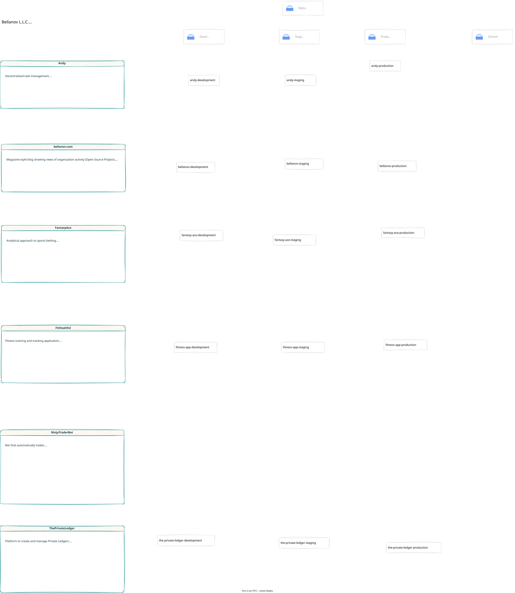
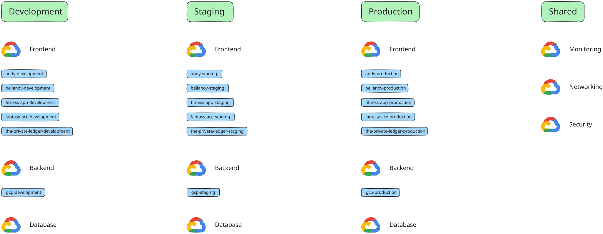

# Bellanov L.L.C.

Code for the _Bellanov L.L.C._ organization.

## Structure

The organization is defined across a series of **Folders** in _Google Cloud Platform (GCP)_.

## Projects

Projects are defined across development **Environments**, namely _Development_, _Staging_, _Production_, and _Shared_.

